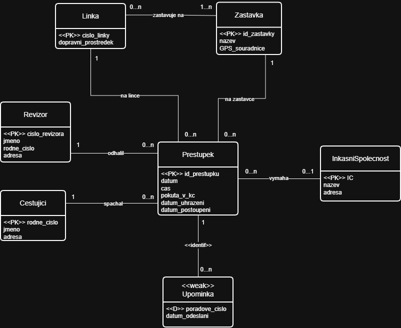

# 8. Černí pasažéři

### vyučující: ing. Michal Rozsíval

Vytvořte co nejjednodušší ER diagram, který bude základem informačního systému (IS) pro dopravní podnik. IS umožňuje evidovat jízdy bez platného dokladu (přestupek), pokuty a jejich vymáhání. V okamžiku, kdy revizor přistihne cestujícího bez platného dokladu, zanese do IS informace o přestupku. O každém přestupku je nutné znát revizora, který přestupek odhalil, cestujícího, který se přestupku dopustil, datum a čas přestupku, číslo linky, nejbližší zastávku, kde došlo k odhalení přestupku, výši pokuty a datum uhrazení pokuty. U cestujícího je nutné evidovat jeho jméno, rodné číslo a adresu, u revizora jeho jméno, rodné číslo, číslo revizora a adresu. Pokud cestující neuhradí pokutu na místě, musí tak učinit do 15 dnů. Pokud nezaplatí ani po této době, jsou mu postupně zasílány upomínky. Počet upomínek se řídí platným řádem. U každé upomínky je třeba evidovat datum odeslání a její pořadí. Pokud cestující nezaplatí ani po poslední upomínce, je pohledávka (vymáhání pokuty) postoupeno inkasní společnosti. V takovém případě je nutné evidovat datum, kdy došlo k postoupení pohledávky. Inkasní společnost má svůj název, identifikační číslo (IČ) a sídlo. Dopravní podnik může mít postupně uzavřenou smlouvu s více inkasními společnostmi.

IS musí umožnit výpis informací o přestupku včetně informací o lince (číslo linky, zastávky a zda se jedná o tramvaj, autobus, nebo trolejbus), zastávce, kde došlo k odhalení přestupku (její název, GPS souřadnice a čísla linek, do kterých zastávka patří), zda byla pokuta uhrazena, příp. kolik upomínek bylo zasláno a zda byla pohledávka postoupena inkasní společnosti a které.

