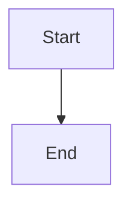

# README.md

This repository contains my uni-related stuff like projects, notes, etc. It has a directory browser hosted on github pages with a markdown renderer for .md files.


# Markdown Render Test:

[TOC]

## Headings

# Heading 1
## Heading 2
### Heading 3
#### Heading 4
##### Heading 5
###### Heading 6

Setext Heading 1
================

Setext Heading 2
----------------

## Paragraphs and Line Breaks

First paragraph with a long line of text that wraps across the width of the page so that line wrapping and paragraph spacing can be seen at a glance.

Second paragraph.

Line ending with two spaces  
next line.

Line ending with a backslash\
next line.

## Emphasis and Inline Formatting

*Italic*, _italic_, **bold**, __bold__, ***bold italic***, **_mixed_ nesting**

~~Strikethrough~~

Inline `code`, double backticks `` `tick` ``

Intra*word*emphasis and snake_case_word

H<sub>2</sub>O, E = mc<sup>2</sup>, <kbd>Ctrl</kbd> + <kbd>C</kbd>, <mark>marked</mark>

## Blockquotes

> Simple blockquote.
>
> Second paragraph.

Separator paragraph.

> Outer
>
> > Nested
> >
> > > Third level
>
> Back to outer with **bold** and `code`.

## Unordered Lists

- Dash one
- Dash two
    - Nested
    - Nested
        - Third level
- Dash three

* Asterisk one
* Asterisk two

+ Plus one
+ Plus two

## Ordered Lists

1. One
2. Two
3. Three
    1. Nested one
    2. Nested two

7. Seven
8. Eight
9. Nine

1. Ordered
2. Ordered

- Unordered
- Unordered

## Lists with Blocks

1. Item with a paragraph.

    Second paragraph in the item.

    ```python
    print("fenced in list")
    ```

        print("indented in list")

2. Item with a quote.

    > Quote in a list item.

## Task List

- [x] Done
- [ ] Open

## Code

Inline: `int main(void)`

Indented block:

    #include <stdio.h>
    int main(void) { return 0; }

Fenced with language:

```c
#include <stdio.h>

int main(void)
{
    printf("Hello, <world> & \"friends\"\n");
    return 0;
}
```

Fenced without language:

```
plain text
    keeps   spacing
```

Tilde fence:

~~~bash
echo "tilde"
ls -la | grep '^d'
~~~

Markdown inside a fence:

```markdown
# Heading
**bold** and [link](https://example.com)
```

Wide line:

```text
0123456789012345678901234567890123456789012345678901234567890123456789012345678901234567890123456789012345678901234567890123456789
```

## Horizontal Rules

---

***

___

## Links

[Inline](https://example.com)

[Inline with title](https://example.com "Title")

[Reference][ref1] and [Another][Ref2] and [ref1]

<https://example.com/autolink>

<someone@example.com>

https://example.com/bare

[Anchor to Tables](#tables)

[Relative markdown link](markdown-raw-test.md)

[Relative markdown link with anchor](markdown-raw-test.md#tables)

[Directory](./)

[File with spaces](my%20file.txt)

[**Bold** and `code` link](https://example.com)

[ref1]: https://example.com/one
[Ref2]: https://example.com/two "Two"

## Images


![Reference image][badge]

[badge]: https://example.com/images/badge.png "Badge"


## Tables

| Left | Center | Right |
|:-----|:------:|------:|
| apple | banana | 1.50 |
| **bold** | `code` | 22.00 |
| [link](https://example.com) | *italic* | 333.00 |
| escaped \| pipe | a | b |

| Name | Description |
|------|-------------|
| One  | First       |
| Two  | Second      |

| Col 1 | Col 2 | Col 3 | Col 4 | Col 5 | Col 6 | Col 7 | Col 8 | Col 9 | Col 10 | Col 11 | Col 12 |
|-------|-------|-------|-------|-------|-------|-------|-------|-------|--------|--------|--------|
| aaaaaaaaaaaa | bbbbbbbbbbbb | cccccccccccc | dddddddddddd | eeeeeeeeeeee | ffffffffffff | gggggggggggg | hhhhhhhhhhhh | iiiiiiiiiiii | jjjjjjjjjjjj | kkkkkkkkkkkk | llllllllllll |

## Raw HTML

Inline: <em>em</em>, <strong>strong</strong>, <code>code</code>

<div style="border: 1px solid gray; padding: 0.5rem;">
A <b>div</b> with **markdown** inside.
</div>

<details>
<summary>Details</summary>

Details body.

</details>

<!-- HTML comment -->

## Escaping and Special Characters

\*asterisks\*, \# hash, \[brackets\], \`backtick\`, 1\. number

&amp; &lt; &gt; &copy; &mdash; &hellip; &nbsp; &#9731; &#x2603;

5 < 6, 7 > 3, AT&T

"double", 'single', -- dashes, ... dots

## Unicode

café, naïve, Zażółć gęślą jaźń, příliš žluťoučký kůň

日本語, 中文, 한국어

مرحبا بالعالم

😀 🚀 ✅ ❌

∑ ∫ √ ≤ ≥ ≠ ∞

## Footnotes, Definitions, Abbreviations

Footnote reference[^1] and another[^note].

[^1]: Footnote text with a link: <https://example.com/footnote-one>.
[^note]: Second footnote text, see [example](https://example.com/footnote-two).

Term
:   Definition

HTML abbreviation.

*[HTML]: Hyper Text Markup Language

## Emoji, Math, Diagrams, Attributes

:smile: :rocket: :warning:

Inline math $E = mc^2$

$$
\int_0^1 x^2 \, dx = \tfrac{1}{3}
$$



Paragraph with attributes {: #custom-id .custom-class }

End.